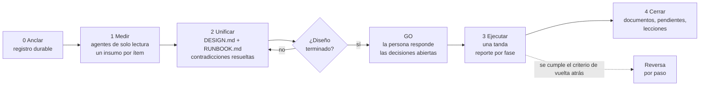

<div align="center">

# design&ship

**Diseña largo. Ejecuta corto.**
Un plugin de Claude Code para cambios de infraestructura, operaciones y trabajo multi-repo: primero mide, obtén un GO y luego ejecuta de una sola tanda limpia.

[](LICENSE)
[](https://code.claude.com/docs/en/plugins)
[](CONTRIBUTING.md)

[English](README.md) | Español

</div>

---

## Por qué

Gran parte del trabajo de infraestructura con agentes sigue este patrón: «haz lo primero... ahora lo siguiente... espera, eso rompe lo primero». Ítem por ítem desde el chat se pierde el orden de dependencias, las contradicciones aparecen en medio del `apply` (el momento más caro) y no queda nada que auditar.

**design&ship invierte el reparto.** Casi todo el esfuerzo va a medir y diseñar. Una persona aprueba decisiones concretas. Después el agente ejecuta la tanda completa, deteniéndose *solo* en las compuertas humanas que el diseño declaró.

> Gastas el tiempo en el diseño. La ejecución es limpia, de golpe y lo más corta posible.

Nada de trabajar sobre la marcha. Nada de «parece que». Cada afirmación se etiqueta **MEDIDO** (con el comando que lo prueba) o **INFERIDO**.

## El flujo



«Diseño terminado» es **falsable**. Lo está si y solo si:

1. El Runbook se ejecuta sin preguntar nada a la persona, salvo en sus compuertas declaradas.
2. Cada paso tiene **acción, compuerta, criterio, control positivo y reversa**.
3. Toda contradicción entre ítems está resuelta **con evidencia**.

## Instalación (30 segundos)

En Claude Code:

```text
/plugin marketplace add moisesjurad0/design-and-ship
/plugin install design-and-ship@design-and-ship
```

La skill se activa sola ante pedidos de infraestructura, migraciones, cortes, borrados y trabajo multi-repo. Para invocarla de forma explícita:

```text
/design-and-ship:design migrar el job de exportación nocturna del servidor A al B, sin caída
/design-and-ship:ship plans/2026-01-15-migracion-export  (después de leer el diseño y dar el GO)
/design-and-ship:close plans/2026-01-15-migracion-export
```

¿Sin Claude Code? El método es Markdown plano. Copia [`prompts/`](plugins/design-and-ship/skills/design-and-ship/prompts) y [`templates/`](plugins/design-and-ship/skills/design-and-ship/templates) a cualquier agente con terminal, o pega el [fragmento para CLAUDE.md](plugins/design-and-ship/skills/design-and-ship/prompts/00-claude-md-snippet.md) en tu `CLAUDE.md` / `AGENTS.md`. Las plantillas y prompts están en inglés; el agente responde en tu idioma.

## Las fases

| Fase | Quién | Qué produce |
|---|---|---|
| **0 · Anclar** | Lead + humano | El trabajo queda registrado en un lugar durable (ticket, nota, issue) antes de empezar |
| **1 · Medir** | Agentes (solo lectura, en paralelo) | Un *insumo* por ítem: qué existe de verdad (AS-IS **medido**), qué se propone, qué puede salir mal |
| **2 · Unificar** | Lead | **Design Doc** y **Runbook**; aquí se cazan las contradicciones entre ítems |
| **GO** | Humano | Responde la lista consolidada de preguntas y aprueba el Runbook. Sin esto no se ejecuta |
| **3 · Ejecutar** | Lead + agentes | El Runbook corre de una tanda, con un reporte por fase en el EXECUTION-LOG |
| **4 · Cerrar** | Lead | Documentos finales, registro cerrado, pendientes explícitos, commit y push |

## Ejemplo resumido

Dos workflows se disparaban al llegar un correo, en una suscripción de nube antigua. En la nueva existían copias apagadas. Objetivo: mover el procesamiento sin perder ni duplicar ningún correo y sin autorización interactiva.

| Lo que midió | Cómo cambió el plan |
|---|---|
| Al habilitar un disparador de correo nuevo se repasa el buzón y se reprocesa lo viejo (45 de 75 ejecuciones en un minuto); la función no es idempotente | Un **filtro de corte** fijado a la hora exacta en que se apagó el workflow anterior |
| El filtro de fecha de la rama existente estaba roto: usaba un parámetro sin declarar y cada ejecución fallaba | Se corrigió y se probó con cinco casos antes de producción |
| Una conexión no puede referenciarse desde otra suscripción | **Mudar** las conexiones (conservan su token) en vez de recrearlas |
| El workflow antiguo ya fallaba 1 de cada 3 por errores de negocio (409/422/400) | El criterio de vuelta atrás separa fallos de plataforma de errores de negocio conocidos |

Relato completo (en inglés): [docs/examples/cutover-two-workflows.md](docs/examples/cutover-two-workflows.md).

## ¿Y por qué no...?

| | Plan mode | Spec-driven development (SDD) | **design&ship** |
|---|---|---|---|
| Ideal para | Una tarea cualquiera | Código nuevo con requisitos poco claros | Infra, operaciones, migraciones, cortes, borrados, multi-repo |
| Pregunta central | «¿Qué voy a cambiar?» | «¿Qué hay que construir?» | «¿Qué existe, qué puede romperse y cómo deshago cada paso?» |
| Parte de | El prompt | Una especificación | **Mediciones** del sistema real |
| Etiquetas MEDIDO / INFERIDO | No | No | **Obligatorias** |
| Reversa por paso | No exigida | No exigida | **Obligatoria** |
| Borrados | Cuando sea | Cuando sea | **Primero propuesta, luego GO explícito** |
| Salida | Un plan | Spec, diseño, tareas | Design Doc, Runbook, **Execution Log** |

Se complementan: SDD para decidir *qué código escribir*; design&ship para decidir *cómo cambiar un sistema vivo con seguridad*.

## Preguntas frecuentes

**¿Es plan mode con pasos extra?** Plan mode produce un plan a partir de lo que el modelo cree. design&ship produce un diseño a partir de lo que se *midió*, exige reversa y control positivo por paso, y separa la aprobación humana en decisiones (antes) y autorizaciones (al ejecutar).

**¿Cuándo NO usarlo?** En arreglos triviales y reversibles. La prueba: *¿puedo escribir ahora, en una línea, el resultado correcto y por qué, y el error es reversible?* Si ambas son «sí», hazlo directo.

**¿Obliga algo?** No. Es una convención sostenida por las instrucciones de la skill y por tu disciplina; no es un hook ni una compuerta automática.

**¿Llama a algún servicio o recopila datos?** No. El plugin es solo Markdown: una skill, tres comandos, plantillas y prompts. Sin hooks, sin servidores MCP, sin red.

## Hoja de ruta

- [ ] Más ejemplos (migración de base de datos, cambio de DNS, rotación de secretos, refactor multi-repo)
- [ ] Comando opcional `/design-and-ship:audit` para revisar un Design Doc contra la regla de «diseño terminado»
- [ ] Hook opcional que bloquee comandos de escritura durante la fase de diseño
- [ ] Plantillas de ADR y Playbook
- [ ] Evaluaciones de la skill (disparo y parada en el GO)

## Contribuir

Las corridas reales mejoran el método: un ejemplo anonimizado o una lección aprendida es la contribución más valiosa. Mira [CONTRIBUTING.md](CONTRIBUTING.md).

## Si te sirve

Dale una estrella al repo para que otros lo encuentren, y cuéntame qué falló o qué cambiarías.

## Licencia

[MIT](LICENSE) © Moisés Jurado
