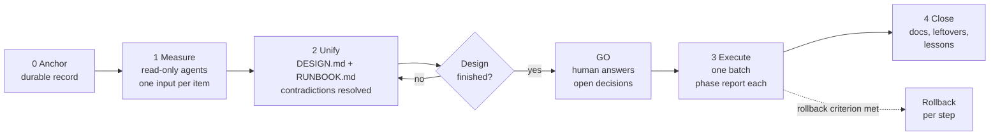

<div align="center">

# design&ship

**Design long. Ship short.**
A Claude Code plugin for infra, ops and multi-repo changes: measure first, get a GO, then execute in one clean batch.

[](LICENSE)
[](https://code.claude.com/docs/en/plugins)
[](CONTRIBUTING.md)
[](https://github.com/moisesjurad0/design-and-ship/actions/workflows/validate.yml)

English | [Español](README.es.md)

</div>

---

## Why

Most agent-driven infra work goes like this: *"do the first thing... ok now the next one... wait, that breaks the first one."* Item by item from the chat, dependency order is lost, contradictions surface mid-`apply` (the most expensive moment), and nothing is left behind to audit.

**design&ship inverts the split.** Nearly all effort goes into measuring and designing. A human approves concrete decisions. Then the agent executes the whole batch, stopping *only* at the human gates the design declared.

> You spend the time on design. Execution is clean, in one go, and as short as possible.

No working on the fly. No "it seems". Every claim is labeled **MEASURED** (with the command that proves it) or **INFERRED**.

## The flow



"Design finished" is **falsifiable**. It is finished if and only if:

1. The Runbook runs without asking the human anything, except at its declared gates.
2. Every step has **action, gate, criterion, positive control, rollback**.
3. Every contradiction between items is resolved **with evidence**.

## Install (30 seconds)

In Claude Code:

```text
/plugin marketplace add moisesjurad0/design-and-ship
/plugin install design-and-ship@design-and-ship
```

Then start working. The skill triggers on its own for infra, migration, cutover, deletion and multi-repo requests. To invoke it explicitly:

```text
/design-and-ship:design migrate the nightly export job from server A to B, no downtime
/design-and-ship:ship plans/2026-01-15-export-migration  (after you read the design and say GO)
/design-and-ship:close plans/2026-01-15-export-migration
```

No Claude Code? The method is plain Markdown. Copy [`prompts/`](plugins/design-and-ship/skills/design-and-ship/prompts) and [`templates/`](plugins/design-and-ship/skills/design-and-ship/templates) into any agent that has a terminal, or paste the [CLAUDE.md snippet](plugins/design-and-ship/skills/design-and-ship/prompts/00-claude-md-snippet.md) into `CLAUDE.md` / `AGENTS.md`.

## What a run looks like

_Illustrative session, condensed from the worked example below._

```text
you   > /design-and-ship:design cut over two mail-triggered workflows to the new subscription,
        no interactive re-authorization possible, Saturday window

agent > Method: design&ship (irreversible-ish, crosses two subscriptions, production traffic).
        Measuring read-only... 6 inputs written to plans/2026-01-15-cutover/inputs/
        Finding that changes the plan: enabling the new trigger re-scans the mailbox and
        reprocesses old mail (MEASURED: 45 of 75 runs in one minute). Neither side is idempotent.
        DESIGN.md + RUNBOOK.md written. Design-finished rule: 3/3.
        Open decisions: D1 ... D3 (each with my recommendation).
        Stopping. Waiting for your GO.

you   > GO. D1: yes. D2: Saturday 22:00. D3: keep the old one 7 days.
        /design-and-ship:ship plans/2026-01-15-cutover

agent > Pre-flight OK (AS-IS unchanged). Phase 1 done, token gate passed (MEASURED: 2/2 Connected).
        Phase 2 done, what-if: 1 Modify, 0 Create, 0 Delete. Phase 3 done. Gap between off and on: seconds.
        Leftovers: 1 flow pending its first real email (not "ok").
```

Full story with the reasoning behind each decision: [docs/examples/cutover-two-workflows.md](docs/examples/cutover-two-workflows.md).

## Worked example (the short version)

Two workflows fired on incoming email in an old cloud subscription. Copies existed in the new one, switched off. Goal: move processing with zero lost or duplicated emails, and no interactive re-authorization.

| What measuring found | How it changed the plan |
|---|---|
| Enabling a new mail trigger re-scans the mailbox and reprocesses old mail (45 of 75 runs in a minute); the function is not idempotent | A **cutoff filter** set to the exact time the old workflow was switched off |
| The existing branch's date filter was broken: it used an undeclared parameter, so every run failed | Fixed and tested on five cases before production |
| A connection cannot be referenced from another subscription | **Move** the connections (they keep their token), do not recreate them |
| The old workflow already failed 1 run in 3, from business errors (409/422/400) | Rollback criterion separates platform failures from known business errors |

Result: a gap of seconds between off and on, `what-if` showed exactly 1 Modify / 0 Create / 0 Delete, and execution was short because the design was long.

## Why not just...

| | Plan mode | Spec-driven development (SDD) | **design&ship** |
|---|---|---|---|
| Best for | One task, any kind | New code with unclear requirements | Infra, ops, migrations, cutovers, deletions, multi-repo |
| Core question | "What will I change?" | "What should be built?" | "What exists, what could break, and how do I undo each step?" |
| Starts from | The prompt | A spec | **Measurements** of the real system |
| Evidence labels (MEASURED / INFERRED) | No | No | **Required** |
| Rollback per step | Not required | Not required | **Required** |
| Deletions | Whenever | Whenever | **Proposal first, explicit GO** |
| Human gates | Approve the plan | Approve spec/design | Approve **decisions** + exact authorizations |
| Output | A plan | Spec, design, tasks | Design Doc, Runbook, **Execution Log** |

They compose: use SDD to decide *what code to write*, design&ship to decide *how to change a live system safely*.

## FAQ

**Is this just plan mode with extra steps?**
Plan mode produces a plan from what the model believes. design&ship produces a design from what was *measured*, forces rollback and a positive control for every step, and splits human approval into decisions (before) and authorizations (at execution). Plan mode is a fine fit for ordinary tasks; this is for the ones where being wrong is expensive.

**How is it different from SDD / spec-driven development?**
SDD answers "what should we build?" and fits code with ambiguous requirements. design&ship answers "how do we change something that already exists and is running?". If your change is mostly new code, use SDD. Its `design.md` and `tasks.md` can play the Design Doc and Plan roles.

**When should I NOT use it?**
Trivial reversible fixes. The test: *can I write now, in one line, the correct result and why, and is the error reversible?* Yes to both means do it directly. The skill applies this test to each item and tells you which method it chose.

**Does it enforce anything?**
No. It is a convention carried by the skill's instructions and your discipline, not a hook or a gate. If the Runbook keeps needing questions outside its gates, the design ended too early.

**Does it call any service or collect anything?**
No. The plugin is Markdown only: one skill, three slash commands, templates and prompts. No hooks, no MCP servers, no network.

**Does it work with agents other than Claude Code?**
The method does. The prompts and templates are plain Markdown. The plugin packaging is Claude Code specific.

## What is inside

```text
.claude-plugin/marketplace.json
plugins/design-and-ship/
├── .claude-plugin/plugin.json
├── commands/            design.md  ship.md  close.md
└── skills/design-and-ship/
    ├── SKILL.md
    ├── templates/       DESIGN.md  RUNBOOK.md  EXECUTION-LOG.md
    ├── prompts/         00-claude-md-snippet  01-design  02-execute  03-close
    └── examples/        cutover-two-workflows.md
docs/                    method.md, examples/
```

Read the method in depth: [docs/method.md](docs/method.md).

## Roadmap

- [ ] More worked examples (database migration, DNS change, secret rotation, multi-repo refactor)
- [ ] Optional `/design-and-ship:audit` command: check a Design Doc against the "design finished" rule
- [ ] Optional hook (opt-in) that blocks write commands during the design phase
- [ ] Templates for ADR and Playbook
- [ ] Translations (Spanish README shipped; more welcome)
- [ ] Eval suite for the skill's triggering and for the stop-at-GO behavior

Have an idea? [Open a feature request](https://github.com/moisesjurad0/design-and-ship/issues/new?template=feature_request.yml).

## Contributing

Real-world runs make this better: if you used the method, an sanitized example or a lesson learned is the most valuable PR. See [CONTRIBUTING.md](CONTRIBUTING.md).

## If it helps you

Star the repo, so others find it, and tell me what broke or what you would change. Issues and PRs are welcome.

## License

[MIT](LICENSE) © Moisés Jurado
